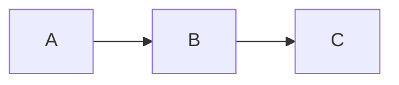

# Skill: design-doc

Convert a plan file or description into a structured design document. Before drafting
anything, this skill interrogates the design — challenging architecture choices, asking about
alternatives, and surfacing gaps. Documents that survive this phase are stronger. Generates a
Markdown file first for review, then optionally creates a Google Doc using the `/gdoc` skill.

## Usage

```
/design-doc [path-to-plan-file]
```

If no plan file is given, describe the work and the skill will structure it from scratch.
Plan files live in `.claude/plans/`. Example: `/design-doc .claude/plans/crdb-60714-k8s-1.35-in-place-resize.md`

## Step 1 — Determine the document type

Ask the user (or infer from the plan content):

| Type | When to use |
|------|-------------|
| Big design | New K8s controller, multi-phase architecture work, cross-team effort requiring approval |
| UX / feature change | New API fields, CRD additions, operator UX changes, work with open design questions |
| Runbook | Operational guide for using or operating a feature; step-by-step procedure for SREs |
| Decision record | Short customer-specific or quick decisions; problem + solution + accepted risks |

When uncertain, default to the simplest type that covers the content. A two-day ticket
usually needs a UX doc at most. A runbook covers "how to operate X" but not "why we built X."

Also ask:
- Is this internal only, or customer-facing?
- Does it need an approval / DACI table?
- Does it have an associated JIRA ticket and/or prerequisite doc?

## Step 1.5 — Interrogate before drafting

Before writing a single line of the document, challenge the design. The goal is to surface
gaps, wrong assumptions, and better alternatives while they are still cheap to change. A
document that survives this phase is a much stronger one.

Ask the questions below that apply to the doc type. Do not ask all of them at once — group
them into 2-3 rounds if needed. Push back when answers are vague or circular.

### Questions for every doc type

- What is the one sentence that explains why this work is being done now, not three months ago
  and not three months from now? If the answer is "it was always needed," press harder.
- What does success look like after this is shipped? How would you know if it is not working?
- What is the simplest version of this that could ship? Is that the right thing to ship, or
  is the full design justified?
- Who else in the team should review or approve this before it is written up?

### Additional questions for big design docs

- What alternatives to this architecture were seriously considered? Why was each rejected?
  If no alternatives were considered, that is a red flag — surface it and explore at least
  two concrete alternatives before proceeding.
- Why is a [state machine / controller / webhook / finalizer] the right abstraction here?
  What would a simpler approach look like and why does it fall short?
- What happens if the controller is killed, panics, or loses leader election mid-operation?
  Is the operation idempotent? Can it be safely re-run from any intermediate state?
- Are there existing patterns in this codebase that solve a similar problem? If so, why is
  a new pattern needed rather than extending the existing one?
- What is the blast radius if this goes wrong in production on a live cluster? What does a
  partial failure look like to the user?
- Are the non-goals truly out of scope, or are they deferred? If deferred, who owns them
  and by when?
- Does this touch the reconciliation hash, pod eviction logic, or status conditions? If so,
  what does a rolling operator upgrade look like — will old pods and new pods interoperate?
- Does this introduce any new persistent state in etcd? If so, what is the migration path
  when that state schema needs to change?

### Additional questions for UX / feature change docs

- Is this the right API surface? If this feature evolves in a year, will the API still work
  or will it need a breaking change?
- Is this a spec field, an annotation, or a label, and is that the right choice? What are
  the mutability implications?
- What is the zero value / omitted-field behaviour? Is it safe? Does it preserve backwards
  compatibility for clusters created before this feature?
- Is this field mutable after cluster creation? What happens if an operator changes it on a
  live cluster — does it trigger a rolling restart, a no-op, or an error?
- Are there CRDB version constraints? Will this field be silently ignored on older CRDB
  versions or will it cause a failure?
- What does the webhook need to validate? Are there combinations of fields that are invalid
  together that the current validation does not catch?

### Additional questions for runbooks

- What are the top three things that go wrong during this operation in practice? Does the
  runbook cover all three, or only the happy path?
- What does the cluster look like to the user if the procedure is abandoned halfway through?
  Is there a recovery path from every step, or are some steps one-way?
- Is there a safer alternative procedure that achieves the same outcome with fewer steps or
  lower risk? If so, why is this one preferred?
- Does this procedure rely on operator behaviour that could change across operator versions?
  If so, note which version the runbook was written for.
- Who has actually run this procedure before? Were there surprises that are not yet captured?

### How to handle the answers

If an answer reveals a genuine gap (no alternatives considered, no idempotency, no blast
radius analysis, undocumented failure modes), do not paper over it in the document. Either
resolve it before drafting or capture it explicitly in the doc as an open question or a
known limitation. A document that acknowledges its own gaps is more credible than one that
pretends to be complete.

If the user pushes back on a question ("it's fine, we don't need to cover that"), note the
decision briefly and move on. One challenge is enough — do not repeat the same objection.

---

## Step 2 — Generate the Markdown file

Write the file to the repo root or the path the user specifies. Name it after the ticket or
feature: `FEATURE_NAME_DESIGN.md`. Use the template for the identified type below.

### Template: Big design

Use for: K8s controller designs, multi-phase architecture work, docs requiring approval.
Follow the numbered-section convention (1. Overview, 2. Motivation, etc.).

```markdown
# Eng Design Doc: [Title]

**Status:** Draft
**Author:**
**Prerequisites:** [link to any prerequisite design docs]

---

## 1. Overview

[2-3 paragraphs. What is being built, why now, and what problem it solves.
State the end goal concisely in the last sentence.]

---

## 2. Motivation

### 2.1 [Root cause or context — the "why now"]

[Explain the current pain without the proposed solution.]

### 2.2 [Secondary driver, if any]

---

## 3. Goals and Non-Goals

### 3.1 Goals

- [Bullet each concrete goal the design must achieve]

### 3.2 Non-Goals

- [Bullet what is explicitly out of scope to prevent scope creep]

---

## 4. Architecture

### 4.1 [High-level component overview]

[Prose description of how the components interact. Keep it abstract here.]

### 4.2 High-Level Interaction Diagram

[Mermaid diagram. Will become an embedded image in GDoc.]



### 4.3 [State machine or data flow, if relevant]

---

## 5. User Experience

### 5.1 How to trigger / invoke

[kubectl commands, label changes, API field changes. Show exact YAML or commands.]

### 5.2 Observing progress

[Status fields, log messages, metrics, events.]

### 5.3 Control surface (pause/resume/rollback)

---

## 6. Detailed Implementation

### 6.1 [Phase or component name]

[Prose + code snippets. Be specific about API calls, state changes, and sequencing.]

### 6.2 [Next phase or component]

---

## 7. Safety, Edge Cases, and Rollback

### 7.1 Rollback semantics

### 7.2 Guardrails and bounds checks

### 7.3 Backwards compatibility

[Are there any API or behaviour changes that break existing users?]

---

## 8. Testing

- [Playback tests to add or update]
- [Integration test scenarios]
- [Edge cases to cover]

---

## 9. Relationship to Broader Work (if applicable)

| Phase | What it delivers | Why it matters |
|-------|-----------------|----------------|
| Phase 1 | | |
| Phase 2 (this doc) | | |

---

## 10. Future Work

- [Explicitly deferred items]

---

## 11. Approval

| Reviewer | Team | Role | Approved? |
|----------|------|------|-----------|
| | | Driver | |
| | | Approver | |
| | | Contributor | |
```

---

### Template: UX / feature change

Use for: new API fields, CRD changes, operator UX changes, feature specs with open questions.
No numbered sections, no formal metadata header, ChangeLog section at the end.

```markdown
# [Feature Name] in Operator

## Introduction

[1-2 paragraphs: what is being added, what problem it solves for users.]

## Current state

[How things work today. What is missing or suboptimal.]

## API specification

[Go struct definition showing the new or changed fields. Example:]

```go
type CrdbNodeSpec struct {
    // NewField controls X. If nil, Y is used as the default.
    NewField *SomeType `json:"newField,omitempty"`
}
```

## Default UX (Helm / CR example)

```yaml
# Example CrdbCluster spec showing the new field in use
spec:
  template:
    spec:
      newField: value
```

## Implementation details

### Without [new field]

[How the code behaves when the field is not set. What defaults apply.]

### With [new field]

[How the code path changes. What the operator does differently.]

## Edge cases and backwards compatibility

- [List breaking changes, if any]
- [List backwards-compatible behaviours preserved]
- [Any migration needed for existing clusters]

## Open questions

**Q1:** [Surface any unresolved design question here.]
Proposal: [Proposed resolution]

**Q2:** [Second question if any]
Proposal:

## ChangeLog

**[Date]** — [Decision made or change from review]
**Initial** — [Original proposal]
```

---

### Template: Runbook

Use for: operational guides for SREs, step-by-step procedures, "how to operate X" docs.
No metadata header. Open with Scope or a one-paragraph framing. Numbered steps.
Reference `/demystify-operations` for operator internals background and `/investigate` for
RCA-style content if the runbook covers diagnosing a failure mode.

```markdown
# [Operation Name] with CockroachDB Operator

[One paragraph: what this doc covers, who it is for, and what the outcome is.
If this is internal only, prefix the title with [Internal].]

## Overview

- [Bullet the key properties: zero-downtime, requires X nodes, risk level, estimated time]

## Scope and assumptions

**Scope:**
- [What situations this runbook applies to]

**Assumptions:**
- [What must be true before starting: cluster health, version, operator version]

## Pre-checks

[Commands to verify the cluster is in a safe state before starting.]

```bash
kubectl get crdbnode -n <ns>
kubectl get pods -n <ns>
```

[SQL checks if relevant]

```sql
SELECT * FROM crdb_internal.ranges WHERE replicas_awaiting_gc_count > 0;
```

## Step-by-step procedure

### Step 1. [Name the step]

[What this step does and why.]

```bash
kubectl annotate crdbnode <name> crdb.io/decommission=true
```

**Note:** [Any safety note or warning about this step]

### Step 2. [Name the step]

[Repeat for each step]

## Monitoring

| Metric / Check | Safe range | Warning |
|----------------|-----------|---------|
| Under-replicated ranges | 0 | > 0 for > 5 min |

## Rollback

[What to do if something goes wrong mid-procedure. Be specific about which steps are reversible.]

## Troubleshooting

### [Symptom or scenario]

**Cause:** [Why this happens]
**Action:** [What to do]

## FAQs

**Q: [Common question]**
A: [Direct answer]
```

---

### Template: Decision record

Use for: customer-specific decisions, short scoping notes, accepted trade-off documentation.

```markdown
# [Customer or Context]: [Decision Being Documented]

## Context and environment

[Customer topology, cluster count, version, any constraints that shaped the decision.]

## Problem statement

[What the customer needs. What constraint or limitation prevents the obvious solution.]

## Proposed solution

[The chosen approach in 2-4 sentences.]

**Implementation:**
1. [Step or action]
2. [Step or action]

## Risks and accepted trade-offs

| Area | Detail | Status |
|------|--------|--------|
| [Risk area] | [What the risk is] | Risk acknowledged |
```

---

## Step 3 — Review and iterate

Show the generated Markdown to the user. Ask:
- Is the content accurate?
- Are there any sections to add or remove?
- Are the open questions captured correctly?
- Does the tone match the audience (internal team vs. customer-facing vs. cross-team)?

Revise until approved.

## Step 4 — Convert to Google Doc (optional)

Ask: "Should I create a Google Doc from this?"

If yes, use the `/gdoc` skill to:
1. Create a new Google Doc with the same title.
2. Set the document heading structure to match the Markdown (H1 → Title, H2 → Heading 1,
   H3 → Heading 2, H4 → Heading 3 in GDoc terminology).
3. Paste each section as formatted content — code blocks as monospace paragraphs, tables
   as GDoc tables, bullets as GDoc bullet lists.
4. For every mermaid diagram in the Markdown, insert a placeholder: `[DIAGRAM: description]`
   as a bold italic line in that position. Mermaid does not render in GDocs — the user will
   need to insert the image manually or export it from a Mermaid renderer.
5. For big design docs, add the Approval table at the end as a GDoc table.

After creating the GDoc, share the link with the user.

## Reusing other skills

For runbooks that cover how the operator works internally, invoke `/demystify-operations`
first to trace the relevant code path, then incorporate the results into the runbook sections
("How it works", "Operator behavior", "Monitoring").

For runbooks that cover diagnosing or root-causing a failure mode, invoke `/investigate`
to get the reconciliation analysis, then summarize it in the "Troubleshooting" section.

## What the document should sound like

**Big design**: formal, third person, numbered sections, high confidence in claims. Rationale
paragraphs explain "why this shape works." Safety and rollback are prominent.

**UX / feature**: semi-formal, iterative. Open questions are surfaced explicitly ("Q1:",
"Proposal:"). The ChangeLog records how decisions evolved. API specs are shown as Go structs
or YAML — not prose descriptions of them.

**Runbook**: instructional, imperative verbs ("Run", "Verify", "Annotate"). Notes and CRITICAL
warnings are prefixed and stand out. Steps are numbered and sub-verified where needed. FAQs at
the end answer what SREs actually ask. Tone is direct, not hedged.

**Decision record**: concise, decision-focused. Documents the constraint first, the choice
second, and explicitly names which risks were acknowledged and accepted.
